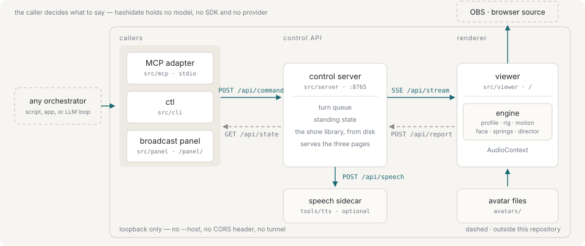

# Architecture

Three processes and a page. A caller posts commands to the control server; the server streams them to the renderer over SSE and the renderer reports back. OBS points at the renderer's page. The viewer and control API bind to `127.0.0.1`.

## Repository layout

| Path | What it holds |
|---|---|
| `src/engine` | The runtime. Profile, rig, anatomy, motion, face, secondary motion, director, session. Depends on three.js and on nothing in a browser. |
| `src/core` | Loads the wasm build of the core and types its exports. The engine calls it; the viewer and the tests load it. |
| `crates/` | The Rust workspace. `hashidate-core` is the core, with no I/O. It owns the avatar's transform hierarchy (the scene graph), the rig, the numeric anatomy, the character frame and the arm transaction, the sway solver and the transparent-triangle sorting. `hashidate-wasm` is the thin C ABI that exposes it as wasm. |
| `src/protocol` | The wire format, as zod schemas. The viewer, the server and the CLI all import it, so the command vocabulary cannot drift between them. |
| `src/viewer` | The renderer: a three.js stage, with a development console beside it. This is the page OBS points at. |
| `src/panel` | The broadcast panel, on `/panel/`. Everything it does goes through the control API, so what it can do is what an orchestrator can do. |
| `src/monitor` | The stage, on `/monitor/`. The same renderer letterboxed to 16:9 with nothing around it — the page an operator watches and OBS monitors. |
| `src/shell` | The native launcher: the two pages as windows, with the server and the sidecar started underneath. A convenience for a development checkout, deliberately not packaged. See [The native shell](shell.md). |
| `src/mascot` | The desktop mascot: one transparent, click-through window that shows the viewer's mascot page, with a tray. Like the shell it is a development launcher and is not packaged. See [The desktop mascot](mascot.md). |
| `src/server` | The local control API. Serves all three pages and carries commands to the renderer. |
| `src/control` | The node-side client for that API, shared by `ctl` and the MCP adapter. |
| `src/cli` | `ctl` — a thin client, for driving the avatar by hand. |
| `src/mcp` | The MCP adapter: the same control API, as tools a language model can be handed. |
| `src/script` | Reads a script: a run of turns written out in advance. It invents no vocabulary — a line is a turn, a setup entry is a command. |
| `tools/blender` | The model pipeline. Python, because it runs inside Blender. |
| `tools/tts` | The speech sidecar. Python, because the speech model is a PyTorch codebase. Reached over HTTP, never imported. |
| `avatars/` | One file per model the operator brings, found by the control server and described in [Avatars](avatars.md). Not tracked; `--avatars` moves it. |
| `show/` | What an operator brings to a broadcast: `slides/`, `scripts/`, `motions/`, `bgm/`. Not tracked and not part of the build; `--slides`, `--scripts`, `--motions` and `--bgm` move those libraries elsewhere. |

## Design boundaries

**The wire vocabulary lives once**, in `src/protocol`, as zod schemas. Adding a command means adding it there first; the viewer, the server and the CLI follow. That is what keeps three processes on separate release cycles from drifting apart.

**Session events are closed on the way in and open on the way out.** A renderer's report is validated strictly. The readers of the event tail (`GET /api/state`, `GET /api/events`) drop an event they cannot validate and keep the rest, so a type or a field added later does not make an older reader throw. The turn and queue events (`turn.queued`, `turn.start`, `turn.end`, `turn.interrupted`, `queue.dropped`, `queue.replaced`, `queue.empty`) and `cue.fire` come from the session; the touches `touch.tap` and `touch.hold` carry an optional `part`, `side` and `count` and are emitted only by the mascot. See [The desktop mascot](mascot.md#touches).

**The engine does not know it is in a browser.** It depends on three.js and on the core, which is computation and not a browser API — no `AudioContext`, no DOM, no `fetch`. The engine calls the core and never loads it; the viewer and the tests do. The avatar's three.js nodes are backed by the core: their position, quaternion, scale and matrices live in the core's memory, and three.js and the TypeScript layers read them unchanged. The rig, anatomy, character frame and arm transaction keep their TypeScript names as facades over the core, and the sway solver and the triangle kernel read the same scene graph. Motion, face, profile, director and session stay in TypeScript. It states what a spoken line is, and the viewer, which has the audio, provides one. That is why the test suite can run the whole engine headlessly against a synthetic avatar.

**The server holds the standing state.** The avatar, the costume, the shot, the set, the acoustic, the voice chain, the BGM transport and the tuning are folded into a setup as they are chosen, and handed to a renderer the moment it attaches, along with the pending queue. Nothing about the show lives in the URL a browser source was configured with, so a reload mid-broadcast is survivable. See [The surfaces](surfaces.md).

**The MCP adapter holds no judgement.** Every tool is one of the HTTP endpoints, with the loaded avatar's own ids compiled into the schemas. It is a translation, not a second control plane. See [The MCP adapter](mcp.md).

**The speech sidecar is proxied, not called.** The viewer reaches it through `POST /api/speech` rather than directly. Having one caller is what lets the voice answer on a UNIX socket instead of a port: no page can name a socket, and nothing outside this machine can reach one. That is the same rule the rest of the runtime follows by binding loopback, applied more strictly. Putting the voice back on a port to make a direct call work is a licensing decision before it is a code change.

## Motion timing

A gesture has an entrance, a held movement and a release. The entrance grows with the distance from the current pose. A body-contact reach carries its wrist along a shoulder-centred arc with a monotone minimum-jerk time profile, so it slows into the contact at the end of the entrance. When that hand is already posed by an outgoing gesture, its pointing direction follows the same progress, including the outgoing gesture's share. Palm rotation keeps its earlier preparation so the wrist does not twist sideways as the forearm moves. A reach from rest keeps its preparatory hand motion; direction-authored poses keep their expressive overshoot. `comeHere` and `bravo` begin their opening sweep after the actual entrance; a longer reach does not consume the sweep while the hands are still arriving.

This timing uses the hand-motion model of [Flash and Hogan (1985)](https://pubmed.ncbi.nlm.nih.gov/4020415/), while preparation and the following movement are kept distinct as in [Kopp and Wachsmuth (2004)](https://doi.org/10.1002/cav.6). The runtime still checks joint limits and body clearance: a smooth time profile alone does not make a path reachable.

Face clearance adjusts the destination before the wrist travels toward it. The elbow solver gradually reduces an authored pole's influence as it approaches the shoulder-to-wrist line, where it no longer gives a reliable bend direction. The final arm transaction still checks the posed joints and fingers before accepting the motion.

An explicit `nod` performs one preparation, downstroke and recovery. Extending its hold does not repeat it. Automatic speech nods use phrase boundaries, following the observations in [Ishi et al. (2007)](https://www.isca-archive.org/interspeech_2007/ishi07_interspeech.pdf). They keep at least 0.6 seconds between starts across consecutive lines. A too-close or late beat is dropped rather than postponed; a nod already in flight finishes. An unpunctuated continuation does not invent a final phrase boundary, while explicit punctuation and the end of a turn remain eligible.

A turn's clocks advance by the frame's real length: gesture time, nods, the gap between turns, the wait for a take, and a mouth with no take to sync to. The integrators (followers, sway, breath) stay on the capped frame step, so after a long frame the body catches up with the voice instead of staying late. A turn queued with an id draws its gesture variation, nod plan, phrase-break blinks and onset gaze aversion from streams seeded by that id, so every renderer playing the turn (preview, stage, OBS) performs it alike. Free-running blinks and gaze wander are not seeded.

## Next

- [The control API](control-api.md)
- [Avatars](avatars.md)
- [The surfaces](surfaces.md)
- [The desktop mascot](mascot.md)
