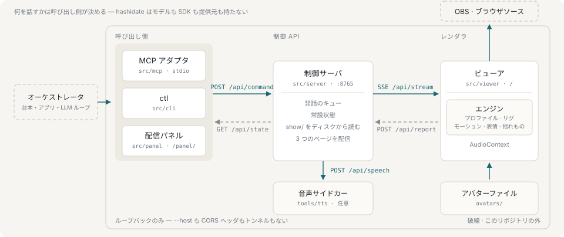

# 構成

プロセスが 3 つとページが 1 つです。呼び出し側が制御サーバにコマンドを投げ、サーバが SSE でレンダラへ流し、レンダラが結果を報告します。OBS はレンダラのページを写します。ビューアと制御 API は `127.0.0.1` に bind します。

## リポジトリの構成

| パス | 中身 |
|---|---|
| `src/engine` | ランタイム本体。プロファイル、リグ、可動域、モーション、表情、揺れもの、ディレクタ、セッション。three.js には依存しますが、ブラウザの API には依存しません。 |
| `src/core` | コアの wasm ビルドを読み込み、その export に型を付けます。エンジンはこれを呼び出し、読み込むのはビューアとテストです。 |
| `crates/` | Rust ワークスペース。`hashidate-core` は I/O を持たないコアで、アバターの変換階層（シーングラフ）、リグ、数値の可動域、キャラクタフレーム、腕のトランザクション、揺れもののソルバ、透過三角形の並べ替えを担います。`hashidate-wasm` はそれを wasm として公開する薄い C ABI です。 |
| `src/protocol` | 通信仕様を zod スキーマで定義したもの。ビューア・サーバ・CLI がこれを共有するので、コマンド語彙が三者でずれません。 |
| `src/viewer` | レンダラ。three.js のステージと、その横に開発用のコンソール。OBS が向くのはこのページです。 |
| `src/panel` | 配信パネル（`/panel/`）。ここでの操作はすべて制御 API を通るので、パネルにできることはオーケストレータにもできます。 |
| `src/monitor` | ステージ（`/monitor/`）。同じレンダラを 16:9 のレターボックスに収めただけのページで、オペレータが見て、OBS が音を拾うのはここです。 |
| `src/shell` | ネイティブの起動役。2 つのページをウィンドウとして開き、サーバとサイドカーを下で立ち上げます。開発用チェックアウトのための便宜であって、意図的にパッケージ化していません。[ネイティブシェル](shell.md)を参照してください。 |
| `src/server` | ローカル制御 API。3 つのページの配信と、コマンドの中継を兼ねます。 |
| `src/control` | その API を呼ぶ Node 側のクライアント。`ctl` と MCP アダプタが共有します。 |
| `src/cli` | `ctl`。手で動かすための薄いクライアントです。 |
| `src/mcp` | MCP アダプタ。同じ制御 API を、言語モデルに渡せるツールの形で話します。 |
| `src/script` | 台本、つまりあらかじめ書いておいたターンの並びを読む部分。語彙は増やしません。1 行がターンそのもので、setup の 1 項目がコマンドそのものです。 |
| `tools/blender` | モデル変換。Blender 組み込みの Python で動くため、ここだけ Python です。 |
| `tools/tts` | 音声サイドカー。音声モデルが PyTorch のコードベースなので、ここも Python です。HTTP 越しに呼ぶだけで import はしません。 |
| `avatars/` | 持ち込むモデル 1 体につきファイル 1 つ。制御サーバが見つけ、[アバター](avatars.md)で説明している形式で読みます。git 管理外で、`--avatars` で場所を移せます。 |
| `show/` | 配信に持ち込むものの置き場。`slides/`、`scripts/`、`motions/`、`bgm/`。git 管理外でビルドにも含まれず、`--slides`・`--scripts`・`--motions`・`--bgm` で各ライブラリの場所を移せます。 |

## 効いている継ぎ目

**通信の語彙は 1 か所にしかありません**。`src/protocol` の zod スキーマです。コマンドを増やすとは、まずここに足すことで、ビューアもサーバも CLI もそれに従います。リリース周期の違う 3 プロセスがずれないのはこれのためです。

**エンジンは自分がブラウザにいることを知りません**。依存するのは three.js とコアだけです。コアは計算であってブラウザの API ではありません。`AudioContext` も DOM も `fetch` も使いません。エンジンはコアを呼び出すだけで読み込まず、読み込むのはビューアとテストです。アバターの three.js ノードはコアが裏付けています。位置・クォータニオン・スケール・行列はコアのメモリにあり、three.js と TypeScript 側はそれを変わらず読めます。リグ、可動域、キャラクタフレーム、腕のトランザクションは、同じ名前の TypeScript ファサードがコアを呼び出し、揺れもののソルバと三角形のカーネルは同じシーングラフを読みます。モーション、表情、プロファイル、ディレクタ、セッションは TypeScript のままです。喋られた台詞とは何かを型で述べるだけで、実際の音は `AudioContext` を持つビューアが用意します。テストがエンジン全体を合成アバターに対してヘッドレスで走らせられるのはこのためです。

**常設状態はサーバが持ちます**。アバター、衣装、画角、背景、音の部屋、声の処理、BGM の再生状態、調律は、選ばれた時点でひとつの設定に畳み込まれ、レンダラが接続した瞬間に、積んである台詞ごと手渡されます。配信の内容がブラウザソースの URL に入っていないので、配信中の再読み込みに耐えます。[操作面](surfaces.md)を参照してください。

**MCP アダプタは判断を持ちません**。どのツールも上の HTTP エンドポイントそのもので、そこに、いま立っているアバターの id をスキーマとして埋め込んであります。2 つめの制御面ではなく、言い換えです。[MCP アダプタ](mcp.md)を参照してください。

**音声サイドカーは直接呼ばず、中継します**。ビューアは `POST /api/speech` 経由で呼びます。呼び手が 1 つだからこそ、声はポートではなく UNIX ソケットで答えられます。ページはソケットを名指しできませんし、この機械の外からは届きません。ランタイムの他が bind をループバックに縛っているのと同じ規則を、より厳しく適用できる場所で適用したものです。直接呼べるように声をポートへ戻すのは、コードの変更である前にライセンスの判断になります。

## モーションの時間配分

ジェスチャーは、入り、姿勢に着いてからの動き、戻りで構成されます。入りの時間は、現在の姿勢からの距離に応じて伸びます。身体に触れる動作では、手首を肩中心の弧に沿って運び、単調な最小躍度曲線で到着前に減速させます。同じ手を使っているジェスチャーから切り替えるときは、指先が向く方向と前のジェスチャーの混合率も同じ進行に合わせます。掌の回転は先行する準備動作を残し、前腕が動く途中で手首が横に折れることを抑えます。休止姿勢から動かすときの手の準備動作と、向きで指定するポーズの表情としての行き過ぎは残しています。`comeHere` と `bravo` は実際の入りが終わってから腕を開くため、移動が長くても、手が到着する前に開く動作が終わることはありません。

時間配分には [Flash と Hogan（1985）](https://pubmed.ncbi.nlm.nih.gov/4020415/) の手の運動モデルを用い、準備とその後の動作を [Kopp と Wachsmuth（2004）](https://doi.org/10.1002/cav.6) のように分けて扱います。関節の可動域と身体への接触判定は引き続き適用されます。時間変化が滑らかでも、通れる経路とは限りません。

顔との接触を避ける補正は、手首を動かす前に到着点へ適用します。肘のソルバは、指定された肘の誘導点が肩と手首を結ぶ直線に近づくほど、その影響を徐々に弱めます。その位置では肘を曲げる方向が定まりにくくなるためです。腕の動作を確定する際には、実際の関節と指の姿勢を引き続き検証します。

明示的な `nod` は、準備、下向きの動作、元の姿勢への復帰を1回行います。保持を延ばしても繰り返しません。発話中の自動的な頷きは、[Ishi ら（2007）](https://www.isca-archive.org/interspeech_2007/ishi07_interspeech.pdf) の観察を参考に、句の区切りで発生させます。連続する台詞をまたいでも、開始間隔を0.6秒以上空けます。直前の頷きに近すぎるものや遅れたものは後送りせず省き、すでに始まった頷きは最後まで動きます。句読点のない継続中の台詞には、末尾の区切りを補いません。明示された句読点とターンの終わりは、引き続き頷きの候補になります。

## 次に読むもの

- [制御 API](control-api.md)
- [アバター](avatars.md)
- [操作面](surfaces.md)
