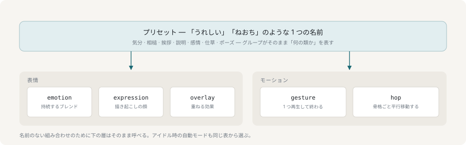

# プリセット

台詞に添えるものは、たいていは**プリセット**です。「うれしい」「ねおち」のように、表情とモーションをひと組の名前にしたものです。



その下の層は、振る舞いが違うので分けてあります。感情は連続値で持続し、ジェスチャは離散的で終わり、跳躍は骨格全体を動かします。ただ、そのどれも呼び出し側が考える単位ではありません。「うれしい」と頼むのは 1 回の呼び出しですが、「joy 0.9 と cheer ジェスチャと 45mm の跳躍 3 回」は 4 回になり、台本ではなくリグの話になります。

## グループ

基本のグループは、気分、相槌、挨拶、説明、感情、仕草、ポーズです。ポーズの動きは解除するまで保持されます。気分は、うつむきや首かしげのような体の構えを持つことがあり、その場合もポーズと同じく解除するまで保たれます。次のグループには、甘えたり、ふざけたり、カメラに向けて決めたりする短いモーションがあります。

| グループ | プリセット ID |
| --- | --- |
| 愛情 | `blowKiss`、`heartHands`、`heartOffer`、`selfHug`、`heartFlutter` |
| おちゃめ | `peekaboo`、`bunnyEars`、`fingerWag`、`pawBounce`、`shoulderShimmy` |
| アイドル | `doubleWave`、`idolPoint`、`spotlight`、`cuteSalute`、`stageBow` |
| 応援 | `fistPump`、`doublePump`、`rahRah`、`encourage`、`bravo` |
| ダンス | `sideSway`、`shoulderBounce`、`handRoll`、`discoPoint`、`tinyDance` |
| 撮影ポーズ | `flowerPose`、`cheekPeace`、`cheekPoints`、`faceFrame`、`modelTilt` |

この 6 グループのモーションは「撮影ポーズ」も含めて自動で終了します。表情の気分は、別の感情やプリセットで置き換えるまで続きます。各 ID は、表情付きのプリセットと、動きだけを再生するジェスチャの両方に使えます。

ポーズには、片手で数える `countOne` から `countFive` と、じゃんけんの `rock`、`scissors`、`paper` も含まれます。感情には、その場で回る `twirl` があります。

```sh
yarn ctl perform blowKiss
yarn ctl perform doubleWave
yarn ctl say "来てくれてありがとう！" --perform flowerPose
```

操作パネルと開発用コンソールでは、グループを選ぶとその中のプリセットが表示されます。日本語名・英語名・ID で全グループを横断検索でき、検索を消すと選択中のグループに戻ります。再生中のプリセットが別のグループにあっても「解除」は使えます。

台詞の `perform` フィールドや、`[heartHands]` のような文中のキューでも指定できます。

エンジンのすべてのジェスチャに対応するプリセットがあり、どのモーションも気分と組み合わせて指定できます。テストでこの対応を確認しています。

## プリセットは状態

新しく始めると前のものが終わります。ポーズは降り、上げた効果は下がり、視線は元に戻り、保っていた体の構えも解かれます。瞼は動きに付いてくるもので、瞼を閉じるジェスチャは、終わるときに開きます。

例外は気分で、これだけは持続します。発話の感情が持続するのと同じ理由で、気分はそれを乗せた文とともに終わるものではないためです。

## 下の層はそのまま呼べる

プリセットに名前のない組み合わせのために、`emotion`・`expression`・`overlay`・`gesture`・`hop` はそれぞれ独立したコマンドとして残してあります。[コマンド](commands.md)を参照してください。

アイドル時の自動モードは、同じ表の中から選ばれたプリセットを使います。上記の 6 グループは明示的に選んだときに再生され、自動モードの候補には入りません。`idle on` にしておけば、呼び出し側が何も送らなくても、発話の合間を自分で埋めます。自動モードは、直近 2 回の選択で使ったジェスチャを繰り返しません。また、起動するたび（台詞の後、セッションの開始時、オンに切り替えたとき）の最初の選択は、ジェスチャではなく気分です。この選択はサーバが一度だけ行って全レンダラに送るので、プレビューにもステージにもキャプチャにも同じアイドルが映ります。

## 常に動いているもの

その下でキャラクターは止まっていません。呼吸、片足からもう片足への重心の移り、スケジューラの引く瞬き、サッカードを伴う視線とそれに遅れて付いてくる頭、一拍遅れて追いつく髪と衣装。どれもコマンドではありませんし、呼び出し側を待ってもいません。

喋っている間は、句の切れ目で頭がうなずきます。うなずきが多いのは文末と、声が実際に間を置いた読点です。話し手が交代する場所では減り、声が続けて読み通した読点では出ません。頭や首を動かすジェスチャが再生されている間は、そのジェスチャを優先して、句末のうなずきは足しません。

瞬きも同じ場所に寄ります。文末、疑問の終わり、行の終わりという文の区切りで、半分ほどの確率で瞬きをします。スケジューラが引く瞬きとは別です。直前の瞬きに近すぎるときは、遅らせずに見送ります。

視線も、続けて喋る区間に合わせて動きます。区間の最初の行は、短く目をそらして始まることがあります。区間の最後の行は、終わる前の 2 秒ほどカメラを見続けます。続けて積まれた行は 1 つの区間として扱います。行の後ろに何も積まれていなければ区間は終わり、割り込みの後や、次の行が積まれるまでに 1 秒ほど空いた後は、新しい区間が始まります。

`idle` はその層のスイッチではなく、その上にある層です。切れば自分で演目を選ぶのをやめるだけで、呼吸は続きます。これらの数値に手が届くのは `tune` のほうで、切り替えではなくカーブごとのフェーダです。

## このアバターが何を持っているか

`GET /api/vocabulary` が、いま立っているアバターが実際に持つプリセットをグループごとに返します。MCP 側では同じ id がツールのスキーマに入るので、モデルは一覧から選ぶだけになります。

```sh
yarn ctl vocab
```

## 次に読むもの

- [原稿と演出](lines-and-cues.md) — 1 行の途中でプリセットを変える
- [コマンド](commands.md) — 下の層
